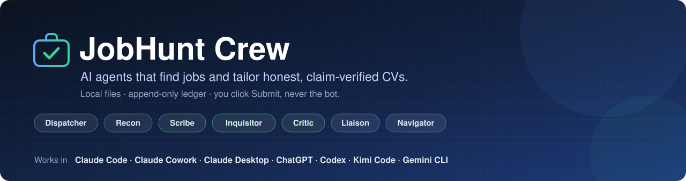
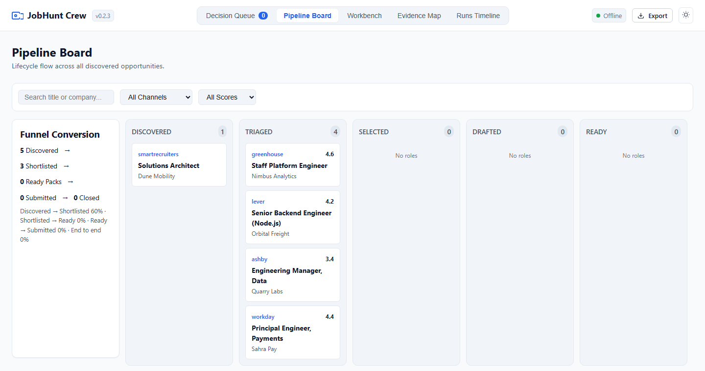
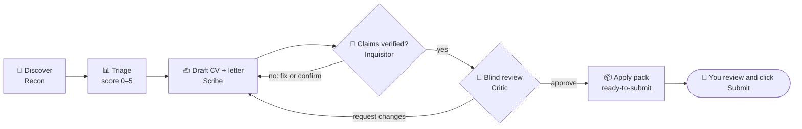
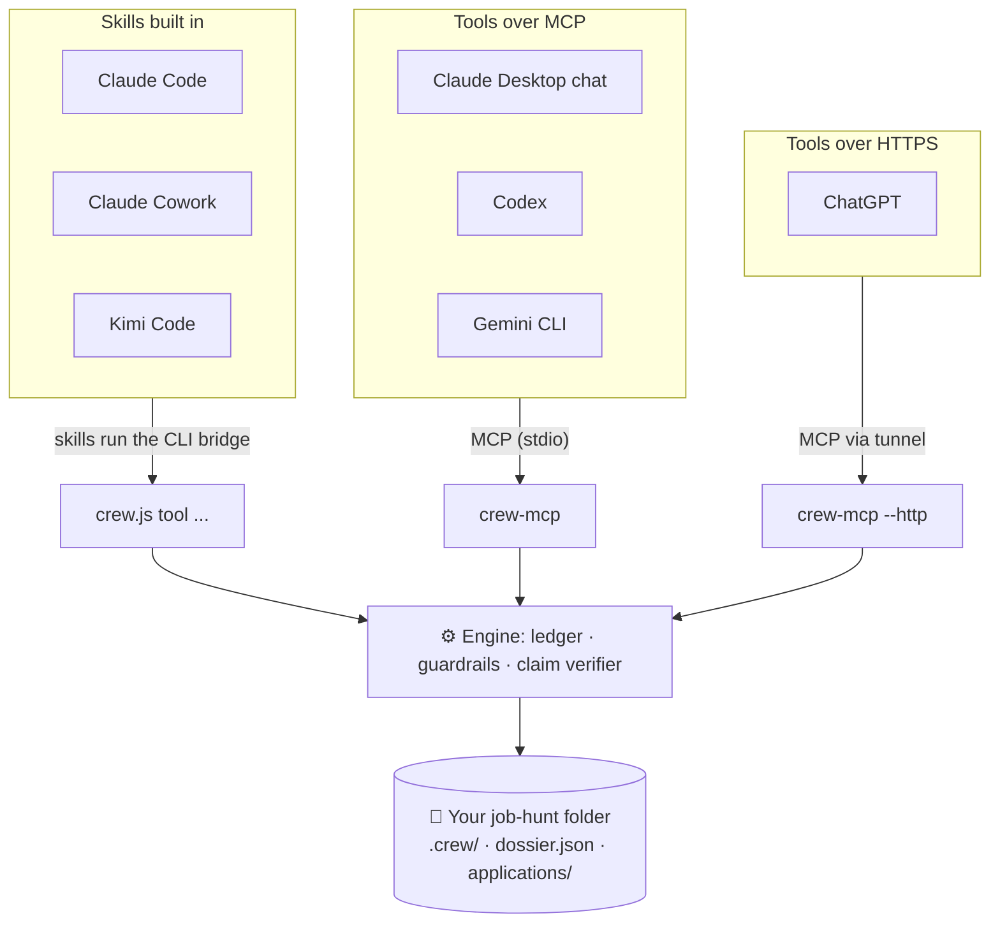
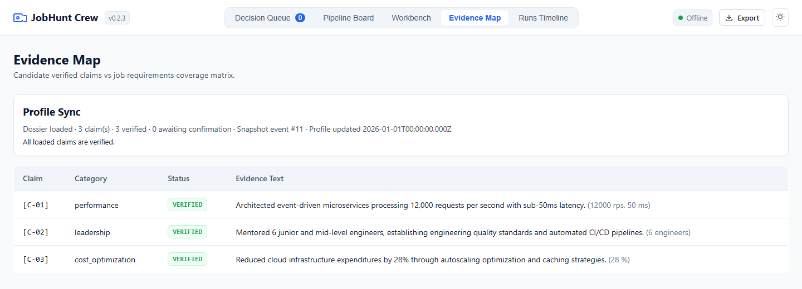
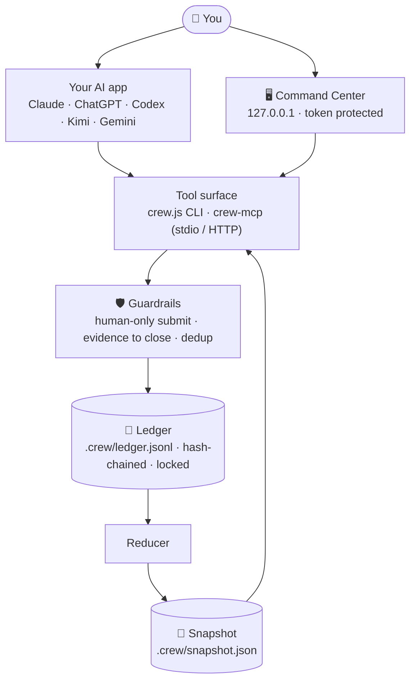

# JobHunt Crew

JobHunt Crew is a local, multi-agent job-search crew that finds roles, tailors honest claim-verified CVs, and stops at ready-to-submit so you are the one who presses Submit.

<p align="center">
  
</p>

<p align="center">
  <a href="https://github.com/LiLara-AI/jobhunt-crew"></a>
  <a href="LICENSE"></a>
  
  
  
  
</p>

<p align="center">
  <b>Find roles · score them · tailor a CV that only says true things · get a ready-to-submit pack · <u>you</u> press Submit.</b>
</p>

---

## ✨ What it does

| Feature | What you get |
|---|---|
| 🔎 **Finds jobs** | Sweeps company career pages directly (Greenhouse, Lever, Ashby, Workday, SmartRecruiters, Oracle Cloud, and more) plus your watchlist. Old postings are never auto-dropped. |
| 📊 **Scores them** | Rates every role 0–5 against your titles, cities, work mode, and hard knockouts. |
| ✍️ **Tailors honest CVs** | Writes the CV and cover letter only from facts in your profile. Every claim is tagged `[C-01]`, `[C-02]`, … |
| 🧪 **Verifies every claim** | A deterministic checker blocks invented numbers, wrong employers, and unconfirmed facts before anything is packaged. |
| 🙈 **Blind review** | A recruiter and a hiring-manager persona review the draft without seeing who you are. |
| 📦 **Apply pack** | Screening answers, a form pre-fill plan, and a clear status. It stops at `ready-to-submit`. |
| 👤 **You stay in charge** | Agents never submit applications, send messages, or enter passwords. Everything lives in files on your computer. |

<p align="center">
  
  <br><sub>The local Command Center (<code>crew ui</code> or <code>crew export</code>): every role from discovery to submission. Demo data, fictional companies.</sub>
</p>

---

## 📚 Contents

- [How it works](#-how-it-works)
- [Pick your app](#-pick-your-app)
- [Install on your app](#-install-on-your-app)
- [Using it (same on every app)](#-using-it-same-on-every-app)
- [The agent crew](#-the-agent-crew)
- [Architecture](#-architecture)
- [Troubleshooting](#-troubleshooting)
- [Development](#-development)

---

## 🔁 How it works



Every step is written to an append-only ledger in your job-hunt folder, so nothing is lost and every decision can be traced.

---

## 🧭 Pick your app

JobHunt Crew runs on plain Node.js 18+ with no dependencies. It reaches each app in one of three ways:



| App | Install | Guided skills | `crew_*` tools | Status |
|---|---|:---:|:---:|---|
| **Claude Cowork** | Marketplace or upload | ✅ | ✅ via skills | ✅ Tested |
| **Claude Code** | Marketplace | ✅ | ✅ via skills, optional MCP | ✅ Tested |
| **Claude Desktop chat** | Edit config file | — | ✅ MCP | ✅ Tested |
| **ChatGPT** | Custom MCP plugin + tunnel | — | ✅ MCP over HTTPS | ✅ Tested |
| **Codex** | `config.toml` | via `AGENTS.md` | ✅ MCP | ✅ Tested |
| **Kimi Code** | `--skills-dir` | ✅ | ✅ via skills | ✅ Tested |
| **Gemini CLI** | Extension | ✅ | ✅ MCP | Not re-tested |
| **Antigravity** | MCP + scheduled tasks | ✅ | ✅ MCP | Not re-tested |

> 💡 **Your job-hunt folder** is any folder you choose (for example `~/JobHunt`). It holds your profile and pipeline. Keep it separate from the plugin folder, which is replaced on every update.

---

## 📥 Install on your app

Click your app to expand the steps. In the steps below, `<plugin>` means the folder where you cloned this repo, and `<workspace>` means your job-hunt folder.

<details>
<summary><b>🟣 Claude Cowork</b> (easiest: no setup beyond installing)</summary>

<br>

**Option A: from the marketplace** (gets automatic updates)

1. Open **Customize → Plugins → + Add → Add marketplace**.
2. Enter `LiLara-AI/jobhunt-crew`, turn on **Sync automatically**, and click **Sync**.
3. Install **jobhunt-crew** from the marketplace.

**Option B: upload the plugin file**

1. Build it once from a clone: `node scripts/build-claude-plugin.js --zip` creates `dist/jobhunt-crew-plugin.zip`.
2. Open **Customize → Plugins → + Add → Upload a plugin** and choose that file.

**Then:** start a task, connect your job-hunt folder, and say:

> *Use the jobhunt-crew setup skill to set up my job search from my resume.*

The skills run the engine for you inside Cowork. No MCP setup is needed.

</details>

<details>
<summary><b>🟠 Claude Code</b> (terminal, VS Code, JetBrains, Desktop Code tab)</summary>

<br>

```bash
claude plugin marketplace add LiLara-AI/jobhunt-crew
claude plugin install jobhunt-crew@lilara-jobhunt
```

Open Claude Code **in your job-hunt folder** and type `/jobhunt-crew:setup`, or just ask *"set up JobHunt Crew from my resume"*.

Optional: register the MCP server so Claude can call the `crew_*` tools directly:

```bash
claude mcp add crew -e CREW_WORKSPACE=<workspace> -- node <plugin>/cli/crew-mcp.js
```

</details>

<details>
<summary><b>🔵 Claude Desktop chat</b> (tools only)</summary>

<br>

1. Clone this repo: `git clone https://github.com/LiLara-AI/jobhunt-crew.git`
2. Open **Settings → Developer → Edit Config** and add:

```json
{
  "mcpServers": {
    "crew": {
      "command": "node",
      "args": ["<plugin>/cli/crew-mcp.js", "--workspace", "<workspace>"]
    }
  }
}
```

3. Restart Claude. Ask *"call crew_doctor"* to check it's connected.

On Windows, use forward slashes in paths, for example `C:/Users/you/JobHunt`.

</details>

<details>
<summary><b>🟢 ChatGPT</b> (web or desktop, tools only)</summary>

<br>

ChatGPT only talks to MCP servers over HTTPS, so you run the server locally and open a tunnel to it.

1. Start the server. It prints a URL that contains a secret token:

```bash
node <plugin>/cli/crew-mcp.js --http --port 8787 --workspace <workspace>
```

2. Open a tunnel (any HTTPS tunnel works):

```bash
cloudflared tunnel --url http://127.0.0.1:8787
```

3. In ChatGPT, open **Plugins → Add → Add custom MCP server**:
   - **Connection:** Server URL `https://<tunnel-host>/mcp/<token>`
   - **Authentication:** No authentication
   - Tick the risk notice, then **Create as a plugin → Connect**.
4. In a chat, type `@` and pick your plugin, then ask *"call crew_doctor"*.

> 🔐 The token in the URL is the password. Anyone with the full URL can read and change your job-hunt data. Don't share it, and stop the tunnel when you're done. Use `--token <secret>` to keep the same URL across restarts. To remove the plugin later: **Settings → Plugins → your plugin → Delete app**.

</details>

<details>
<summary><b>⚫ Codex</b> (ChatGPT plan: CLI, IDE, app)</summary>

<br>

Add to `~/.codex/config.toml`:

```toml
[mcp_servers.crew]
command = "node"
args = ["<plugin>/cli/crew-mcp.js", "--workspace", "<workspace>"]
```

Copy `<plugin>/rules/AGENTS.md` into `<workspace>/AGENTS.md` so Codex follows the operating rules, then run Codex from `<workspace>`. To use a guided workflow, point Codex at it: *"follow `<plugin>/skills/honest-cv/SKILL.md` for this job"*.

</details>

<details>
<summary><b>🌙 Kimi Code</b> (CLI)</summary>

<br>

From your job-hunt folder:

```bash
kimi --skills-dir <plugin>/skills
```

Then ask *"use the jobhunt-crew setup skill"*. The skills run the engine through the CLI bridge, so no MCP setup is needed. Optionally copy `<plugin>/rules/AGENTS.md` to `<workspace>/AGENTS.md`.

> Kimi's web chat (kimi.com) can't run local tools. Use Kimi Code.

</details>

<details>
<summary><b>🔷 Gemini CLI</b></summary>

<br>

```bash
gemini extensions install <plugin>
```

`gemini-extension.json` registers the MCP server and loads `rules/AGENTS.md`. Set `CREW_WORKSPACE=<workspace>` or start Gemini from your job-hunt folder.

</details>

<details>
<summary><b>🛰️ Google Antigravity</b> (scheduled, autonomous crew)</summary>

<br>

1. Register the MCP server in Antigravity's MCP settings:

```json
{ "mcpServers": { "crew": { "command": "node", "args": ["<plugin>/cli/crew.js", "mcp", "--workspace", "<workspace>"] } } }
```

2. Install the scheduled agents:

```bash
node <plugin>/lib/setup-antigravity-tasks.js --install-sidecars --timezone Asia/Riyadh --hour 8
```

The Dispatcher wakes each morning, checks the ledger, and starts only the agents that have work.

</details>

---

## 🚀 Using it (same on every app)

Once installed, the workflow is the same everywhere. **Apps with skills** (Cowork, Claude Code, Kimi, Gemini, Antigravity) guide you step by step. **Tools-only apps** (Claude Desktop chat, ChatGPT, Codex) run the same `crew_*` tools when you ask for them.

### Your first session

1. 🧩 **Set up** from your resume and confirm each fact it extracts (*"set up JobHunt Crew from my resume"*).
2. 🔎 **Sweep and triage**: let Recon find and score roles, then shortlist the ones you like.
3. ✍️ **Draft**: pick a role and get a claim-verified CV, cover letter, and blind review.
4. 📦 **Review the apply pack**, attach the files, and click **Submit** yourself.
5. 📬 **Follow up**: Liaison reminds you on day 7 and day 14 and drafts the note.

### What to say

| Goal | Skill | Try saying |
|---|---|---|
| 🧩 Set up from your resume | `setup` | *"Set up JobHunt Crew from my resume"* |
| 🔄 Update facts, preferences, or style | `update` | *"Add my new certification and re-check my drafts"* |
| ✍️ Tailor an application | `honest-cv` | *"Tailor my CV and cover letter for this job"* + paste the posting |
| 🏢 Several roles at one company | `apply-multi-vacancy` | *"I want to apply to these 3 roles at the same company"* |
| 🤝 Outreach and follow-ups | `contacto` | *"Draft a short note to the hiring manager for this role"* |
| 🎤 Interview prep | `interview-prep` | *"Run a mock interview for this role"* |
| 💼 Offer review | `offer-review` | *"Review this offer: 25,000 SAR total, Riyadh"* |

In Claude Code you can also type the skill directly, for example `/jobhunt-crew:honest-cv`.

### Handy commands (any terminal)

```bash
node <plugin>/cli/crew.js doctor --workspace <workspace>       # health check
node <plugin>/cli/crew.js ui --workspace <workspace>           # open the Command Center
node <plugin>/cli/crew.js export --workspace <workspace>       # one-file offline dashboard
node <plugin>/cli/crew.js tool list                            # every crew_* tool and its arguments
node <plugin>/cli/crew.js tool crew_get_snapshot --workspace <workspace>
```

<p align="center">
  
  <br><sub>Evidence Map: each claim in your profile, its status, and the proof behind it.</sub>
</p>

---

## 🤖 The agent crew

| Agent | Does | Model tier |
|---|---|---|
| 🧭 **Dispatcher** | Checks the ledger and wakes only the agents that have work; daily briefing | Fast |
| 🔎 **Recon** | Sweeps boards and company career APIs, removes duplicates, scores roles | Fast |
| ✍️ **Scribe** | Writes tailored CVs, cover letters, and apply packs from verified claims only | High |
| 🧪 **Inquisitor** | Runs the claim verifier, enforces `[CONFIRM]`, checks keyword coverage | High + script |
| 🙈 **Critic** | Blind recruiter + hiring-manager review, with your identity removed | High |
| 📬 **Liaison** | 7/14-day follow-ups, outreach drafts under 300 characters, scam checks | Fast |
| 🧑‍✈️ **Navigator** | Checks job-board logins and pre-fills forms, stopping before Submit | Fast |

---

## 🏗️ Architecture



- **Ledger first.** Every change is an event appended to `.crew/ledger.jsonl`, hash-chained and written under a file lock, so several agents can work at once.
- **Snapshot is derived.** `.crew/snapshot.json` is rebuilt from the ledger and never edited by hand.
- **Rules live in code.** Only a human can mark an application submitted, a role closes only with evidence (404/410, closure notice, passed deadline, rejection), and an apply pack shows *NOT RUN* until verification and review have actually happened.

<details>
<summary><b>🧱 Core principles</b></summary>

<br>

- **Local-first:** your data never leaves your computer unless you choose to share it.
- **Honest CV:** every metric, title, employer, and date must map to a dossier claim; unconfirmed facts are marked `[CONFIRM]` and block packaging.
- **Blind review:** the Critic sees the draft with your identity scrubbed.
- **No age penalty:** a posting's age never lowers its score or closes it.
- **Human in the loop:** agents prepare and pre-fill; you review and submit.
- **Privacy:** strings in your `.pii-denylist` never appear in generated files or shared output.

</details>

<details>
<summary><b>💎 Gemini Desktop companion</b></summary>

<br>

A companion edition for the Gemini desktop app reads `.crew/snapshot.json`, watches Gmail for recruiter signals, and writes suggestions to `<workspace>/inbox/proposals/`. The core engine validates those proposals (including claim verification) before anything changes. Browser automation, the Command Center, ATS sweeps, and ledger locking stay in the core engine. See [`gemini-desktop-pack/`](gemini-desktop-pack/).

</details>

---

## 🩺 Troubleshooting

| Problem | Fix |
|---|---|
| Cowork: **"Marketplace sync failed"** | Use version 0.2.3 or later. If it still fails, give the Claude GitHub App access to this repo (GitHub → Settings → Applications → Claude → Repository access), or use **Upload a plugin** instead. |
| Cowork: **"may not ship bin/ executables"** | You have a version older than 0.2.3. Update or re-upload. |
| Files land in the wrong folder | Pass `--workspace <folder>` or set `CREW_WORKSPACE`. Never use the plugin folder as your workspace. |
| ChatGPT can't connect | Check that the server and tunnel are both running, the URL ends with `/mcp/<token>`, and authentication is set to **No authentication**. |
| Kimi: unknown `--mcp-config-file` | Current Kimi Code uses `--skills-dir` instead (see the Kimi steps). |
| Job-board sweep finds nothing | The sandbox may block internet access (Cowork can). `crew discover smoke` reports this clearly. |
| Anything else | Run `node <plugin>/cli/crew.js doctor --workspace <workspace>` and share the output. |

---

## 🛠️ Development

```bash
git clone https://github.com/LiLara-AI/jobhunt-crew.git && cd jobhunt-crew
npm test                     # end-to-end suite (922 checks)
npm run test:unit            # unit tests
npm run test:all             # + clean-room, zero-PII, forbidden-token, packaging gates
```

The marketplace installs from `plugins/jobhunt-crew/`, a committed build of this repo for Claude. After changing skills, agents, or engine code, rebuild and commit it (a test fails if it drifts):

```bash
node scripts/build-claude-plugin.js --out plugins/jobhunt-crew   # marketplace bundle
node scripts/build-claude-plugin.js --zip                        # dist/jobhunt-crew-plugin.zip for upload
claude plugin validate plugins/jobhunt-crew
```

In the Claude bundle the entry scripts ship as `cli/` instead of `bin/`, because claude.ai rejects plugins with a top-level `bin/` folder.

---

## 📄 License

MIT © 2026 JobHunt Crew Authors. See [LICENSE](LICENSE) and, for attributions and clean-room provenance, [NOTICE](NOTICE).
